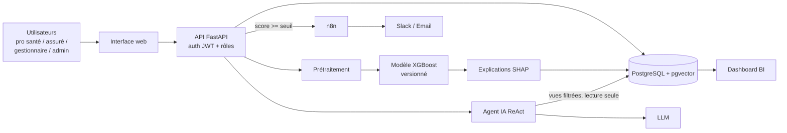

# PrediCare TPA

Plateforme intelligente de **détection de fraudes médicales**, d'**optimisation des remboursements santé** et d'**assistant conversationnel RAG agentique**, développée dans le cadre du projet Capstone Cohorte IA (Orange Digital Center x Ingedata).

> **Statut : v1 (socle).** Les éléments marqués ✅ sont en place, 🚧 en cours, ⏳ à venir. Mettre à jour ce tableau au fil du projet.

## 1. Problème métier

- La fraude, la surconsommation d'actes et les erreurs de tarification représentent **8 à 15 %** des remboursements.
- Les centres d'appels sont saturés par des demandes de suivi de dossier et d'interprétation de garanties.

PrediCare TPA automatise le contrôle des factures et des ordonnances, explique chaque alerte (SHAP), et répond aux assurés grâce à un agent IA sécurisé.

## 2. Fonctionnalités

| Fonctionnalité | Description | Statut |
|---|---|---|
| Scoring de factures | API FastAPI + XGBoost, score de fraude en temps réel | 🚧 |
| Explicabilité | Valeurs SHAP stockées et affichées pour chaque alerte | ⏳ |
| Anomalies de prescription | Doublons, incohérence prescription / pathologie | ⏳ |
| Alertes automatiques | Workflow n8n : score ≥ seuil → Slack  | ⏳ |
| Assistant RAG agentique | Agent ReAct sur contrats PDF (pgvector) + historique SQL | ⏳ |
| Dashboard BI | Volumes traités, montants économisés, taux de détection | ⏳ |
| Administration | Seuil d'alerte modifiable en direct, versions du modèle, supervision | ⏳ |
| Socle d'exploitation | Docker, migrations, sauvegarde/restauration, `/health`, `/metrics` | ✅ |

## 3. Architecture



**Les 3 flux**

1. **Analytique** : facture → validation → prétraitement → inférence → SHAP → stockage → alerte n8n si score ≥ seuil.
2. **Assistant** : question de l'assuré → agent ReAct → contrats (RAG) et/ou historique SQL → réponse sourcée.
3. **Pilotage** : tableau de bord alimenté en continu par la base.

**Une seule base** PostgreSQL + pgvector : données métier, prédictions, SHAP, vecteurs RAG, journal d'audit.

## 4. Stack technique

| Couche | Technologie |
|---|---|
| Base de données | PostgreSQL 16 + pgvector |
| API | FastAPI, Pydantic, JWT |
| ML | XGBoost, SHAP, scikit-learn |
| RAG / Agent | Embeddings + pgvector, agent ReAct, LLM |
| Workflow | n8n (Slack / email, Mailhog en test) |
| Interface | react |
| Supervision | `/health`, `/metrics`, logs JSON |
| Déploiement | Docker Compose |
| Qualité | pytest, ruff, GitHub Actions |

## 5. Structure du dépôt

```
predicare/
├── docker-compose.yml        # Orchestration de tous les services
├── .env.example              # Modèle de configuration (copier en .env)
├── Makefile                  # Raccourcis : make up / down / backup / reset
├── db/
│   ├── migrations/           # Schéma versionné (001, 002, 003...)
│   └── seed/                 # CSV de données synthétiques (chargés au 1er démarrage)
├── api/
│   ├── Dockerfile
│   ├── requirements.txt
│   └── app/
│       ├── main.py           # Point d'entrée FastAPI (/health, /metrics)
│       ├── routers/          # Endpoints (invoices, alerts, admin, chat...)
│       └── services/         # Logique métier (scoring, registre de modèles, notifications, dérive)
├── ml/                       # Prétraitement et entraînement (partagés API / notebooks)
├── models/                   # Modèles versionnés : v1/, v2/ ...
├── ui/                       # Interface web
├── n8n/workflows/            # Workflows exportés (.json), importables
├── scripts/
│   ├── migrate.py            # Migrations + rôles + seed + comptes démo (idempotent)
│   ├── backup.sh             # Sauvegarde (pg_dump)
│   ├── restore.sh            # Restauration
│   └── backup_loop.sh        # Sauvegarde quotidienne automatique
├── tests/                    # Tests pytest
├── backups/                  # Sauvegardes (non versionnées)
└── .github/workflows/ci.yml  # Intégration continue
```

## 6. Démarrage rapide

**Prérequis** : Docker et Docker Compose.

```bash
git clone <url-du-depot> && cd predicare
cp .env.example .env          # puis modifier les mots de passe et secrets
docker compose up -d --build  # ou : make up
```

| Service | URL |
|---|---|
| Interface web | http://localhost:8501 |
| API (docs Swagger) | http://localhost:8000/docs |
| Santé de l'API | http://localhost:8000/health |
| n8n | http://localhost:5678 |
| Boîte mail de test (Mailhog) | http://localhost:8025 |

Au premier démarrage, `scripts/migrate.py` crée le schéma, les rôles de base de données, charge les données de `db/seed/` et crée les comptes de démonstration.

## 7. Comptes de démonstration

Mot de passe commun : valeur de `DEMO_PASSWORD` dans `.env`.

| Rôle | Email |
|---|---|
| Professionnel de santé | pro@predicare.local |
| Assuré | assure@predicare.local |
| Gestionnaire | gestionnaire@predicare.local |
| Administrateur | admin@predicare.local |

## 8. Exploitation

```bash
make backup                              # sauvegarde manuelle dans ./backups
make restore FILE=backups/<fichier>.dump # restauration
docker compose restart                   # les données persistent (volume pgdata)
docker compose logs -f api               # journaux
```

Une sauvegarde automatique est réalisée toutes les 24 h (7 dernières conservées). Le guide d'exploitation complet est prévu dans `docs/`.

## 9. Sécurité et conformité (aperçu)

- **Pseudonymisation** : les identités réelles sont isolées dans `insured_identities` (colonnes chiffrées) ; le reste de la base n'utilise que des pseudonymes.
- **Agent IA en lecture seule** : le rôle `agent_ro` n'accède qu'à des vues filtrées sur l'assuré connecté (identifiant issu du JWT, jamais du texte du chat).
- **Rôles et droits** : l'API utilise un rôle `app_rw` distinct du propriétaire du schéma.
- **Secrets** : uniquement dans `.env` (non versionné).
- **Traçabilité** : journal d'audit en base ; version du modèle enregistrée pour chaque prédiction.
- Données **entièrement synthétiques** : aucune donnée de santé réelle.

## 10. Tests et qualité

```bash
make test     # pytest
make lint     # ruff
```

La CI GitHub Actions exécute ruff, les migrations sur un Postgres pgvector éphémère, puis pytest.

## 11. Équipe

| Membre | Rôle |
|---|---|
| _Nom_ | A : Data & ML |
| _Nom_ | B : Backend & MLOps |
| _Nom_ | C : RAG, Agent & Sécurité |
| _Nom_ | D : Interface, BI & Business |

## 12. Documentation

À ajouter dans `docs/` au fil du projet : guide utilisateur, guide d'exploitation, analyse TCO / ROI, rapport RGPD et EU AI Act, spécification de sécurité.
