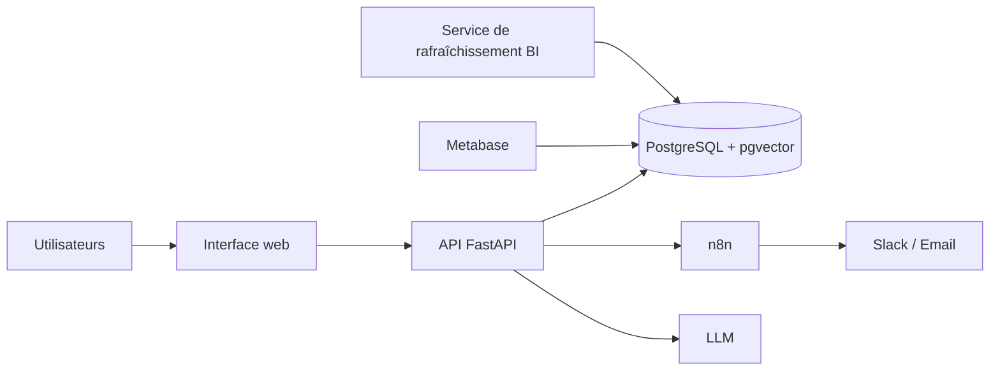

# PrediCare TPA

**Plateforme de détection des fraudes médicales, d'aide au contrôle des
remboursements santé et d'assistance conversationnelle RAG.**

Projet Capstone — Cohorte IA — partenariat Orange Digital Center (ODC) et
Ingedata.

> **Données 100 % synthétiques.** Aucune donnée de santé réelle n'est utilisée
> dans ce projet.

## Sommaire

1. [Présentation](#1-présentation)
2. [Fonctionnalités](#2-fonctionnalités)
3. [Architecture](#3-architecture)
4. [Démarrage rapide](#4-démarrage-rapide)
5. [Configuration](#5-configuration)
6. [Utilisation par rôle](#6-utilisation-par-rôle)
7. [Structure du dépôt](#7-structure-du-dépôt)
8. [Exploitation](#8-exploitation)
9. [Tests](#9-tests)
10. [Sécurité et conformité](#10-sécurité-et-conformité)
11. [Organisation de l'équipe](#11-organisation-de-léquipe)
12. [Documentation](#12-documentation)

## 1. Présentation

La gestion du tiers payant et de l'assurance santé implique le contrôle de
volumes importants de factures, la détection d'anomalies et le traitement de
demandes de suivi de dossier. PrediCare TPA regroupe ces opérations dans une
plateforme composée d'une API, d'une interface web, d'outils de notification,
d'un assistant conversationnel et d'un tableau de bord BI.

La plateforme analyse les factures et signale les anomalies avec des
explications. Elle assiste les gestionnaires, mais **ne prend aucune décision
automatique** : le gestionnaire examine chaque alerte, la valide ou la rejette,
et sa décision est tracée.

## 2. Fonctionnalités

| Domaine | Fonctionnalités |
|---|---|
| Données | Ingestion et nettoyage, quarantaine des lignes invalides, pseudonymisation et séparation des identités chiffrées |
| Machine learning | Scoring des factures et détection d'anomalies |
| Explicabilité | Facteurs contribuant aux alertes, notamment avec SHAP |
| Ordonnances | Détection de doublons et d'incohérences prescription/pathologie |
| API | API FastAPI, authentification, rôles et validation des entrées |
| Alertes | Workflows n8n et notifications configurables |
| Assistant | Assistant RAG sur les contrats et l'historique autorisé, avec réponses sourcées |
| Pilotage | Tableau de bord BI, indicateurs opérationnels et suivi de l'actualisation des données |
| Exploitation | Sauvegarde et restauration PostgreSQL, supervision et tests |

## 3. Architecture



Les principaux flux sont :

1. **Analyse des factures** : ingestion, prétraitement, scoring, explications,
   enregistrement et, si nécessaire, notification au gestionnaire.
2. **Assistance conversationnelle** : question de l'utilisateur, recherche
   dans les sources autorisées, puis réponse avec références.
3. **Pilotage des opérations** : consultation dans Metabase des indicateurs de
   facturation et des alertes, à partir des données BI actualisées.

Le tableau de bord est **lisible et documenté, et dédié au pilotage des
opérations**. Sa documentation — accès, données, définitions des indicateurs et
procédure de mise à jour — se trouve dans
[bi/README.md](./bi/README.md).

### Services et accès locaux

| Service | Rôle | Adresse |
|---|---|---|
| `web` | Interface utilisateur | <http://localhost:5173> |
| `api` | API FastAPI | <http://localhost:8000> |
| Documentation API | Référence interactive | <http://localhost:8000/docs> |
| Santé API | Vérification de l'API | <http://localhost:8000/health> |
| `n8n` | Workflows de notification | <http://localhost:5678> |
| `metabase` | Tableaux de bord BI | <http://localhost:3000> |
| `mlflow` | Registre ML, profil `train` | <http://localhost:5000> |

## 4. Démarrage rapide

### Prérequis

- Docker et Docker Compose v2 ;
- 8 Go de RAM recommandés ;
- ports libres : 3000, 5000, 5173, 5678 et 8000.

### Installation

Depuis la racine du dépôt :

```bash
cp .env.example .env
```

Compléter les secrets requis dans `.env`, notamment `N8N_DB_PASSWORD`, puis
démarrer les services :

```bash
docker compose up --build -d
```

Le service `loader` initialise le schéma et charge les données fournies. Le
tableau de bord Metabase est initialisé depuis `bi/dashboard.json`.

### Arrêt

```bash
docker compose down
```

Cette commande conserve les données. Pour supprimer les volumes et remettre
l'environnement local à zéro :

```bash
docker compose down -v
```

> `down -v` supprime les données locales de la base et des autres volumes.
> À réserver à une remise à zéro volontaire.

## 5. Configuration

La configuration se fait dans `.env`, créé à partir de `.env.example`. Ce
fichier contient les paramètres de la base, des rôles PostgreSQL, de l'API,
des notifications, du RAG, de Metabase et des sauvegardes.

| Paramètre | Utilité |
|---|---|
| `POSTGRES_*` | Connexion à PostgreSQL |
| `DB_*_PASSWORD` | Mots de passe des rôles applicatifs à privilèges limités |
| `PSEUDO_HMAC_KEY`, `IDENTITY_ENCRYPTION_KEY` | Pseudonymisation et protection des identités |
| `JWT_SECRET` | Signature des jetons d'authentification |
| `ALERT_THRESHOLD` | Seuil initial de déclenchement des alertes |
| `LLM_API_KEY`, `LLM_MODEL` | Accès au modèle de langage |
| `SLACK_WEBHOOK_URL`, `ALERT_EMAIL_TO` | Canaux de notification |
| `N8N_DB_PASSWORD`, `N8N_ENCRYPTION_KEY` | Connexion et chiffrement n8n |
| `METABASE_RO_PASSWORD`, `MB_SESSION_SECRET_KEY` | Accès BI en lecture seule et signature des sessions Metabase |
| `BACKUP_ENCRYPTION_KEY` | Chiffrement des sauvegardes du profil `ops` |

Les valeurs fournies dans `.env.example` sont destinées au développement.
Générer des secrets propres à chaque environnement et ne jamais versionner le
fichier `.env` ni de secrets de production.

## 6. Utilisation par rôle

L'interface web propose différents parcours selon les droits attribués :

| Rôle | Parcours |
|---|---|
| Professionnel de santé | Déposer une facture et suivre son traitement |
| Assuré | Interroger l'assistant et consulter les informations autorisées |
| Gestionnaire | Examiner les alertes et leurs explications, puis consigner une décision |
| Administrateur | Superviser la plateforme et gérer sa configuration |

Les comptes et mots de passe de démonstration sont configurés pour le
développement uniquement. Ne pas les utiliser en production.

## 7. Structure du dépôt

```text
.
├── backend/
│   ├── api/                  # API, authentification et rôles
│   ├── ml/                   # Modèles et traitement ML
│   ├── rag/                  # Assistant, indexation et protections
│   ├── ingestion/            # Ingestion et nettoyage
│   └── tests/                # Tests backend
├── bi/
│   ├── dashboard.json        # Définition exportable du tableau de bord
│   └── README.md             # Documentation BI
├── database/
│   ├── backup/               # Image du service de sauvegarde
│   ├── ingestion/            # Jeux de données et labels
│   ├── metabase/             # Initialisation Metabase
│   └── migrations/           # Migrations de base de données
├── docs/                     # Guides et documentation de cadrage
├── frontend/                 # Interface React
├── n8n/workflows/            # Workflows de notification
├── scripts/                  # Scripts de sauvegarde et restauration
├── .env.example              # Modèle de configuration
└── docker-compose.yml        # Services Docker Compose
```

## 8. Exploitation

### Sauvegarde et restauration

Le service de sauvegarde s'exécute avec le profil `ops`. Définir
`BACKUP_ENCRYPTION_KEY` dans `.env`, puis lancer :

```bash
docker compose --profile ops up -d backup
```

Les scripts `scripts/backup.sh` et `scripts/restore.sh` (ou leurs équivalents
PowerShell) permettent également de lancer les opérations manuellement. Voir
le [guide d'exploitation](./docs/guides/guide_exploitation.md) pour les
procédures et précautions de restauration.

### Modèles et supervision

Le service MLflow est associé au profil `train`. L'API expose un contrôle de
santé sur `/health`. Les journaux des services sont consultables avec
`docker compose logs <service>`.

### Mise à jour du tableau de bord BI

La définition versionnée du tableau de bord se trouve dans
`bi/dashboard.json`. Incrémenter sa version puis recréer le service
d'initialisation pour appliquer la mise à jour :

```bash
docker compose up -d --force-recreate metabase-init
```

Les indicateurs, les limites d'interprétation et la procédure détaillée sont
décrits dans [bi/README.md](./bi/README.md).

## 9. Tests

Les tests backend sont définis dans `backend/tests/`. Depuis la racine du
dépôt, avec les dépendances Python installées :

```bash
cd backend
pip install -r requirements.txt
pytest
```

La vérification SQL des KPI BI est documentée dans
[bi/README.md](./bi/README.md).

## 10. Sécurité et conformité

- L'authentification et les rôles sont contrôlés par l'API.
- Les accès BI et assistant doivent utiliser des comptes à privilèges limités.
- Les secrets restent hors du dépôt ; les clés de chiffrement doivent être
  conservées séparément des sauvegardes.
- Les réponses de l'assistant s'appuient sur les sources autorisées et sont
  conçues pour limiter les risques liés aux instructions non fiables.
- Les alertes ne remplacent pas la décision du gestionnaire.

Les documents de cadrage RGPD, AI Act et équité se trouvent dans
`docs/cadrage_et_gouvernance/`. Les guides sont disponibles dans `docs/guides/`.

## 11. Organisation de l'équipe

| Membre | Rôle | Périmètre |
|---|---|---|
| À compléter | Données, BI, RGPD | Base, ingestion, pseudonymisation et tableau de bord |
| À compléter | ML et explicabilité | Modèle, scoring et explications |
| À compléter | Plateforme et MLOps | Docker, API, notifications et supervision |
| À compléter | RAG et sécurité | Assistant, protections et validation |

### Workflow Git

- branches courtes `feat/...`, `fix/...` et `docs/...` ;
- changements intégrés par pull request après relecture et vérifications ;
- commits au format `type(portée): description`.

## 12. Documentation

| Sujet | Emplacement |
|---|---|
| Tableau de bord lisible et documenté, dédié au pilotage des opérations | [bi/README.md](./bi/README.md) |
| Définition exportable du tableau de bord | [bi/dashboard.json](./bi/dashboard.json) |
| Documentation RGPD, AI Act et équité | [docs/cadrage_et_gouvernance/](./docs/cadrage_et_gouvernance/) |
| Guide d'exploitation | [docs/guides/guide_exploitation.md](./docs/guides/guide_exploitation.md) |
| Guides complémentaires | [docs/guides/](./docs/guides/) |

---

*Projet pédagogique réalisé dans le cadre de la Cohorte IA. Données synthétiques uniquement.*
